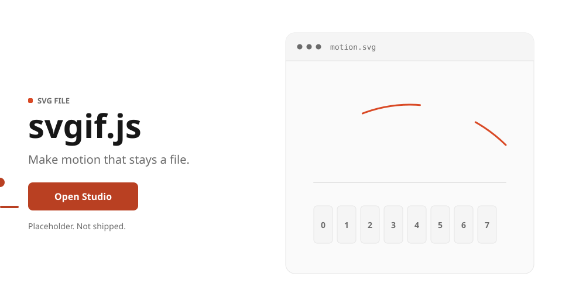
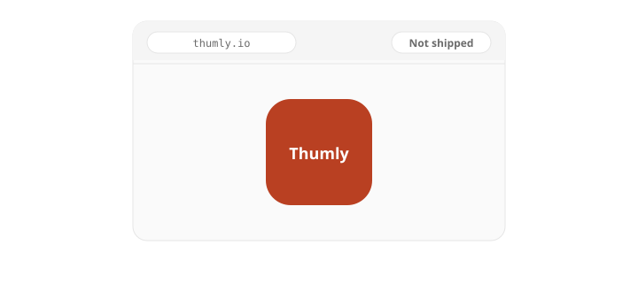
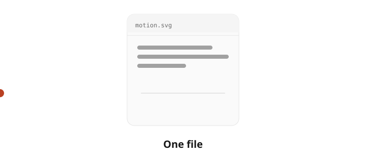
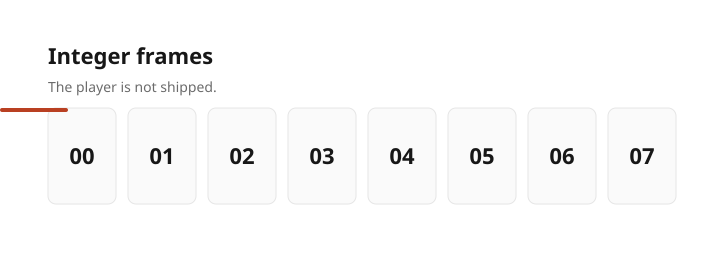

# svgif.js

<picture>
  <source media="(prefers-color-scheme: dark)" srcset="docs/assets/readme/hero-dark.svg">
  
</picture>

Make motion that stays a file.

svgif.js is an SVG animation library. The scene stays SVG, timelines are integer frames, and playback runs in the browser. There is no product server and no server-side encode.

The engine is not shipped. Studio is not built. Thumly is not shipped. The pictures on this page are hand-drawn. The design records under `.spec/` are the source until the engine exists.

The package name is `@modootoday/svgif`. Do not install the unscoped npm package `svgif`.

[Open Studio](https://thumly.io/studio/)

## Thumly

<picture>
  <source media="(prefers-color-scheme: dark)" srcset="docs/assets/readme/thumly-dark.svg">
  
</picture>

Thumly is one static app at `apps/thumly`. Version 1 copy is English. The host is `https://thumly.io/`. `www.thumly.io` is not a second site. It redirects to the apex. The app is not shipped and is not running.

## One file

<picture>
  <source media="(prefers-color-scheme: dark)" srcset="docs/assets/readme/file-dark.svg">
  
</picture>

| Backend | Stands alone |
| --- | --- |
| `css-external` | No. An external stylesheet does not travel inside a single SVG. |
| `css-embedded` | Yes. The same CSS is one `<style>` in the file. |
| `smil` | Yes. The motion is SMIL elements in the file. |

## Frames

<picture>
  <source media="(prefers-color-scheme: dark)" srcset="docs/assets/readme/frames-dark.svg">
  
</picture>

Timelines sample integer frames. The player is not shipped.

## Routes

The docs home is [svgif.js](https://thumly.io/docs/). Studio is [Open Studio](https://thumly.io/studio/). The user guide is [Guide](https://thumly.io/docs/guides/). The API reference is [API](https://thumly.io/docs/reference/api/).

| Path | Page |
| --- | --- |
| `/` | Thumly landing |
| `/studio/` | Studio |
| `/docs/` | Docs home |
| `/docs/getting-started/` | Getting started |
| `/docs/guides/` | User guide |
| `/docs/reference/api/` | API reference |
| `/docs/reference/cli/` | CLI reference |
| `/docs/reference/schema/` | Human schema docs |
| `/docs/agents/` | Agent Skills and MCP |
| `/embed/` | Player |
| `/oembed` | Static oEmbed path. Not a query endpoint. |
| `/works/` | Examples gallery |
| `/schema/svgif/v1.json` | Machine-readable schema. The schema role publishes the file. |

## Library CDN

`SVGIF_CDN_BASE` is unset. This page does not say the CDN is already serving files. Once `SVGIF_CDN_BASE` is set, the origin is `https://cdn.thumly.io/svgif`. jsDelivr and unpkg are secondary documentation URLs. They are not the origin of `cdn.thumly.io`. Exact-version URLs are the ones that carry SRI. Alias URLs do not. Studio on Pages uses relative URLs and does not boot from the CDN. CDN object keys `/svgif/<version>/` stay. This package does not rename them.

License: MIT OR Apache-2.0.
